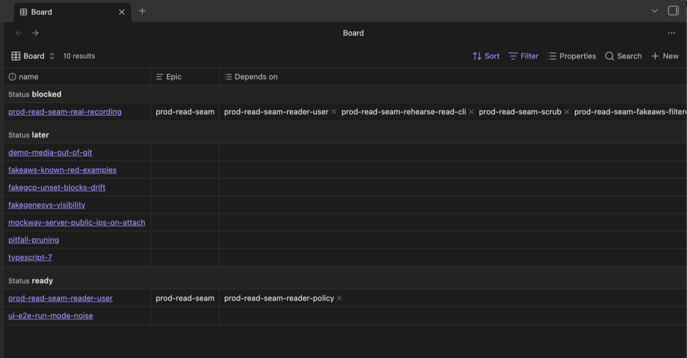

# swarm-dev

[](https://github.com/redscaresu/swarm-dev/actions/workflows/ci.yml)
[](https://scorecard.dev/viewer/?uri=github.com/redscaresu/swarm-dev)

swarm-dev runs a team of Claude Code agents that build software while you watch. You write a design
with one agent. Others plan it, try to break the plan, and build it in parallel, each in its own
terminal pane. The run stops whenever a decision is yours.


## How it works

<picture>
  <source media="(prefers-color-scheme: dark)" srcset="docs/assets/swarm-flow-dark.png">
  
</picture>

You agree the design, approve the epics and stories, merge PRs, and do the steps only a person can.
Your own Claude session is the lead: it runs `/swarm`, keeps an eye on the agents, and handles
`kind: lead` stories, which cover real cloud, credentials and anything hard to undo. Your steps in
those stories are marked **You:**. Agents plan, conduct and build the rest. Each builder gets its
own worktree and pane, shows that its tests can fail, and fixes the review findings (codex and
`/code-review`) on its own PR.

Two loops feed what reviews find back into the work:

| Loop | What happens |
|---|---|
| Inner (one PR) | codex and `/code-review` review the PR, the lead sends findings back with `swarm.sh tell`, and the builder fixes and pushes. This repeats until a pass on the latest head finds nothing substantive. Each fixed finding is logged with `swarm.sh log-finding <kind>`. |
| Outer (across PRs) | When a kind of finding has been fixed in 3 or more PRs within 90 days, or the lead has a memory tagged `lesson: <kind>`, `swarm.sh lessons` turns it into a one-line rule PR titled `lesson: <kind>` for the brief or `lessons_file`. Later builders read that rule. You merge or close it, and a rule you closed is not proposed again for 90 days. |

The full method is in [`docs/method.md`](docs/method.md). The diagram's source is
[`docs/assets/swarm-flow.workflow.json`](docs/assets/swarm-flow.workflow.json), made with
[Archify](https://github.com/tt-a1i/archify).

## Requirements

You need [Claude Code](https://claude.com/claude-code) 2.1.145 or later, [herdr](https://herdr.dev), the
[GitHub CLI](https://cli.github.com) and the [codex CLI](https://github.com/openai/codex), with both
CLIs logged in, plus `git`, `python3` and `bash`. herdr is the terminal multiplexer every agent runs
in, and `/hld`, `/plan-epic` and `/swarm` stop outside it.

swarm.sh reads each agent's state from `claude agents --json`, which older versions lack, so it
refuses to start an agent on anything before 2.1.145. It also refuses when the session you run it
from is missing from that list. In either case, run `claude update` and restart Claude Code.

[Obsidian](https://obsidian.md) is optional. It shows `docs/` as a vault through `Board.base` and
`HLDs.base`, but the board is plain Markdown with front matter and works without it.



## Getting started

1. Install the requirements above.
2. Install the plugin, then restart Claude Code:

   ```bash
   claude plugin marketplace add redscaresu/swarm-dev && claude plugin install swarm-dev@swarm-dev
   ```

3. From your project's root, run `swarm.sh init` (or run `/swarm`, which offers to do it). It
   copies the board into `docs/`, leaving any file already there alone, creates `.claude/swarm/`
   and adds `.swarm/` and the Obsidian lines to `.gitignore`. Running it again changes nothing.

   Then run `claude` once in the repo and accept "do you trust this folder?". Agents work in
   worktrees of the repo, and `swarm.sh` won't start until it is trusted.
4. Inside herdr, run `claude`, then `/hld Add rate limiting to the API`. Agree the design with the
   co-author, then run `/swarm`. Run it again each time it stops for you.

| Command | What it does |
|---|---|
| `/hld <title>` | Write the design with a co-author agent. |
| `/swarm` | Run everything after the design, stopping when a decision is yours. |
| `swarm.sh status` | Show agents that need a look (from their Claude session: waiting, gone or unknown), what waits on you, and what runs next. |
| `swarm.sh dash --watch` | Open the live dashboard shown above ([details](docs/dash.md)). |
| `swarm.sh cost` | Show where the tokens went. |
| `swarm.sh outcomes [--since YYYY-MM-DD]` | Print one TSV row per builder: the story, its kind and risk, the model and effort, cost, tells, findings fixed, the PR and how it ended, and which attempt it was. |

You can also put builder rules in `.claude/swarm/brief.md` and settings such as `merge = agent` in
`.claude/swarm/config` ([all settings](docs/method.md#configuring-a-project)). On Foundry, Bedrock
or Vertex, load your provider settings in `~/.zshrc` so herdr panes pick them up. An alias won't
reach them:

```bash
[[ -n "$HERDR_ENV" ]] && claude() { ( source ~/path/to/your-provider-env.sh && command claude "$@" ) }
```

## When `/swarm` stops for you

| You see | Do |
|---|---|
| a draft design | finish it with the co-author, then agree it |
| proposed epics or stories | approve them, or say what to change |
| a `lead` story | say go, and do its **You:** steps |
| a PR waiting for you | merge it, or close it to send the story back |
| a `blocked` or `later` item | nothing, or set it `ready` / `active` to start it |
| a proposed rule (`lesson: <kind>`) | merge to adopt it, or close it |

## Cost and safety

Every agent is a full Claude Code session, on a model chosen by its role (`swarm.sh policy <role>`).
Planning one epic starts about ten agents. Agents use your own `claude`, `codex`, `gh` and `git`
logins and never touch real cloud or credentials. By default no agent merges, so every green,
reviewed PR waits for you. When codex hits its usage limit, review continues with `/code-review`
and the PR says so.

`/swarm` tells you when a new version is out. To update, run
`! claude plugin marketplace update swarm-dev`, then `! claude plugin update swarm-dev@swarm-dev`,
and restart. See [`SECURITY.md`](SECURITY.md) for security, [`AGENTS.md`](AGENTS.md) for working on
swarm-dev itself, and [`scripts/demo-dash.sh`](scripts/demo-dash.sh) for the dashboard demo.

## License

Apache-2.0.
