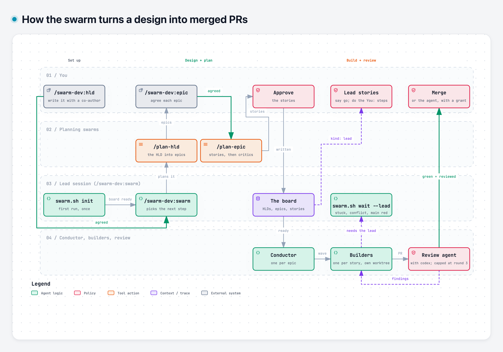

# swarm-dev

[](https://github.com/redscaresu/swarm-dev/actions/workflows/ci.yml)
[](https://scorecard.dev/viewer/?uri=github.com/redscaresu/swarm-dev)

**A team of Claude Code agents that builds software while you watch.** You write a design with one
agent; others plan it, attack the plan and build it in parallel, each in its own terminal pane. The
run stops whenever a decision is yours.


## How it works

<picture>
  <source media="(prefers-color-scheme: dark)" srcset="docs/assets/swarm-flow-dark.png">
  
</picture>

- **You** agree the design, approve the epics and stories, merge, and do the steps only a person can.
- **Your Claude session (the lead)** runs `/swarm`, supervises, and runs `kind: lead` stories: real
  cloud, credentials, anything hard to undo. Your own steps in them are marked **You:**.
- **Agents** plan, conduct and build everything else. Each builder gets a worktree and a pane, proves
  its tests can fail, and fixes the review findings (codex + `/code-review`) on its own PR.

**Two learning loops.**

| Loop | What happens |
|---|---|
| Inner (one PR) | codex and `/code-review` review the PR; the lead sends findings back with `swarm.sh tell`; the builder fixes and pushes, until a pass on the latest head finds nothing substantive. Each fixed finding is logged with `swarm.sh log-finding <kind>`. |
| Outer (across PRs) | `swarm.sh lessons` turns a kind fixed in 3+ PRs in 90 days, or a lead memory tagged `lesson: <kind>`, into a one-line rule PR titled `lesson: <kind>` for the brief or `lessons_file`, so later builders get it. You merge or decline it; a rule you declined is not proposed again for 90 days. |

Full detail: [`docs/method.md`](docs/method.md). Diagram source:
[`docs/assets/swarm-flow.workflow.json`](docs/assets/swarm-flow.workflow.json) (made with
[Archify](https://github.com/tt-a1i/archify)).

## Requirements

- **Required:** [Claude Code](https://claude.com/claude-code); [herdr](https://herdr.dev), the
  terminal multiplexer every agent runs in (`/hld`, `/plan-epic` and `/swarm` stop outside it); the
  [GitHub CLI](https://cli.github.com) and [codex CLI](https://github.com/openai/codex), both logged
  in; `git`, `python3` and `bash`.
- **Optional:** [Obsidian](https://obsidian.md), to view `docs/` as a vault through `Board.base` and
  `HLDs.base`. The board is plain Markdown with front matter, so nothing needs Obsidian.

## Getting started

1. Install the requirements above.
2. Install the plugin, then restart Claude Code:

   ```bash
   claude plugin marketplace add redscaresu/swarm-dev && claude plugin install swarm-dev@swarm-dev
   ```

3. Add the board to your project, from its root:

   ```bash
   git clone --depth 1 https://github.com/redscaresu/swarm-dev /tmp/swarm-dev
   mkdir -p docs .claude/swarm && cp -Rn /tmp/swarm-dev/templates/docs/. docs/
   printf '.swarm/\ndocs/.obsidian/*\n!docs/.obsidian/app.json\n' >> .gitignore
   ```

   Run `claude` once in the repo and accept "do you trust this folder?": agents work in worktrees
   of it, and `swarm.sh` refuses to start until it is trusted.
4. Inside herdr, run `claude`, then `/hld Add rate limiting to the API`. Agree the design with the
   co-author, then run `/swarm`, and run it again each time it stops for you.

| Command | What it does |
|---|---|
| `/hld <title>` | Write the design with a co-author agent. |
| `/swarm` | Everything after that; stops when a decision is yours. |
| `swarm.sh status` | Agents that need a look, what waits on you, what runs next. |
| `swarm.sh dash --watch` | The live dashboard above ([details](docs/dash.md)). |
| `swarm.sh cost` | Where the tokens went. |

**Optional:** builder rules in `.claude/swarm/brief.md`; settings such as `merge = agent` in
`.claude/swarm/config` ([all settings](docs/method.md#configuring-a-project)). On Foundry, Bedrock or Vertex, load your
provider settings in `~/.zshrc` for herdr panes, not in an alias:

```bash
[[ -n "$HERDR_ENV" ]] && claude() { ( source ~/path/to/your-provider-env.sh && command claude "$@" ) }
```

## When `/swarm` stops for you

| You see | Do |
|---|---|
| a draft design | finish it with the co-author, then agree it |
| proposed epics or stories | approve them, or say what to change |
| a `lead` story | say go, and do its **You:** steps |
| a PR waiting for you | merge it, or close it to send the story back |
| a `blocked` or `later` item | nothing, or set it `ready` / `active` to start it |
| a proposed rule (`lesson: <kind>`) | merge to adopt it, or close it |

## Cost and safety

- Every agent is a full Claude Code session on a model picked by its role (`swarm.sh policy <role>`);
  planning one epic starts about ten agents.
- Agents use your own `claude`, `codex`, `gh` and `git` logins, never real cloud or credentials.
- By default no agent merges: every green, reviewed PR waits for you.
- When codex hits its usage limit, review goes on with `/code-review` and the PR says so.

Updating: `/swarm` tells you when a version is out; run `! claude plugin marketplace update swarm-dev`
then `! claude plugin update swarm-dev@swarm-dev`, and restart. Security: [`SECURITY.md`](SECURITY.md).
Working on swarm-dev itself: [`AGENTS.md`](AGENTS.md). The dashboard demo is
[`scripts/demo-dash.sh`](scripts/demo-dash.sh).

## License

Apache-2.0.
