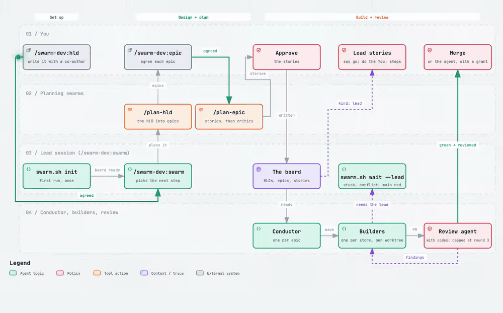

# swarm-dev

[](https://github.com/redscaresu/swarm-dev/actions/workflows/ci.yml)
[](https://scorecard.dev/viewer/?uri=github.com/redscaresu/swarm-dev)

swarm-dev is a Claude Code plugin that turns a piece of work you describe into reviewed, merged
pull requests. You agree what to build with one agent. Other agents split it into small stories,
build them in parallel and review each other's PRs. You watch, and you decide whenever a decision
is yours.


## Who it is for

You have a GitHub repository, a piece of work bigger than one PR (a feature, a release, a
clean-up), and Claude Code. You want it built the way a careful team would build it: planned,
split into PRs that can each be reviewed, tested in CI, and merged only when someone has checked
it. swarm-dev runs that team for you. Every agent runs in its own terminal pane, so you can watch
any of them at work.

## How it works

<picture>
  <source media="(prefers-color-scheme: dark)" srcset="docs/assets/swarm-flow-dark.png">
  
</picture>

1. **You describe the work.** `/swarm-dev:hld` opens a co-author agent. Together you write a short
   design: the problem, the goals you can check, and what is out of scope. You can start from one
   epic instead with `/swarm-dev:epic`.
2. **Agents plan it.** Your agreed design is split into epics, and each epic into stories of one PR
   each. Other agents read your code and try to break the plan before you see it. You agree each
   epic and approve its stories. Nothing is built until you do.
3. **Agents build it.** A conductor starts one builder per story, each in its own git worktree.
   Stories that do not touch the same code are built at the same time.
4. **Agents review it.** Every PR gets a review agent, plus codex, a second reviewer from a
   different model family. The builder fixes what they find. From the third round, only
   regressions and false statements go back, so a review does not loop for ever.
5. **It merges.** By default you merge each green, reviewed PR. You can let the agents merge too.
   A PR that touches CI, hooks or the build always waits for you.

Your own Claude session is the **lead**. It runs `/swarm-dev:swarm`, watches the agents, and does
the steps no agent may: anything with real cloud access, credentials, or that is hard to undo.

All of it is kept on a **board**: plain Markdown files in your repo (designs, epics and stories).
A run can stop anywhere, and the next `/swarm-dev:swarm` picks up where it left off.



## Requirements

| Needs | Version | What for |
|---|---|---|
| [Claude Code](https://claude.com/claude-code) | 2.1.145+ | runs every agent |
| [herdr](https://herdr.dev) | 0.9.2+ | the terminal multiplexer: one pane per agent |
| [GitHub CLI](https://cli.github.com) | logged in | PRs, CI checks, merges |
| [codex CLI](https://github.com/openai/codex) | logged in | the second reviewer, a different model family |
| `git`, `python3`, `bash` | any recent | the `swarm.sh` scripts |
| a GitHub repo | with `make check` | CI and the pre-commit hook run it |
| [Obsidian](https://obsidian.md) | optional | browse the board as a vault |

## Getting started

1. Install the plugin, then restart Claude Code:

   ```bash
   claude plugin marketplace add redscaresu/swarm-dev && claude plugin install swarm-dev@swarm-dev
   ```

2. In your project's folder, run `claude` once and accept "do you trust this folder?". Agents cannot
   start in a folder you have not trusted.
3. Inside herdr, run `claude`, then `/swarm-dev:swarm`. Type the whole name. With your yes, it sets
   up the board, a CI workflow and a pre-commit hook. It also tells you about any Claude Code
   setting to add first, such as the rule that lets agents run `swarm.sh merge`.
4. Run `/swarm-dev:swarm` again. The first time, it asks a few questions for the builders: your
   commit trailers, where credentials live, and commands that must never run. Commit the
   `.claude/swarm/brief.md` it writes.
5. Run `/swarm-dev:hld <title>` and write your first design with the co-author. When you agree it,
   run `/swarm-dev:swarm`. From then on it plans, builds and reviews, and stops each time it needs
   you. Run `/swarm-dev:swarm` again after each stop.

You can ask your agent "how do I use swarm-dev?" or "why did /swarm-dev:swarm stop?" at any time.

## When `/swarm-dev:swarm` stops for you

It stops only for decisions that are yours. The common ones:

| You see | Do |
|---|---|
| a draft design or epic | finish it with the co-author, then agree it |
| proposed epics or stories | approve them, or say what to change |
| a `lead` story | say go, and do its **You:** steps (cloud, credentials, anything hard to undo) |
| a PR waiting for you | review and merge it, or close it to send the story back |
| an agent's login expired | run `/login`, then tell `/swarm-dev:swarm` it is done |
| an agent waiting on a prompt | answer it in the pane the lead names |

[Every stop, and what to do](docs/running.md#every-stop-and-what-to-do) has the full list.

## Watching it

- `swarm.sh dash --watch`: the live dashboard in the recording above.
- `swarm.sh status`: what needs a look and what waits on you.
- `swarm.sh flow`: what the run cost, where the time went, and how the reviews did.

## Cost and safety

Every agent is a full Claude Code session on your own logins, so a run spends real tokens.
`swarm.sh flow` shows where they went.

- No agent touches real cloud or credentials. That work is a `lead` story, done in your own session
  while you watch.
- Agents start with a short list of environment variables. Nothing else you exported reaches them
  unless you allow it.
- A hook guards every session: it refuses raw PR merges and git commands that would throw away work.
- Nothing merges until you say so, unless you choose to let the agents merge. Even then, PRs that
  change CI, hooks, Claude settings or the build always wait for you.

[Cost and safety](docs/running.md#cost-and-safety) has every rule.

## Updating

```bash
claude plugin marketplace update swarm-dev && claude plugin update swarm-dev@swarm-dev
```

Restart Claude Code afterwards. [Updating](docs/running.md#updating) covers moving running agents
to the new version.

## More

- [Running swarm-dev: the details](docs/running.md): each step of a run, every stop, watching,
  safety, updating and the test tooling.
- [The method](docs/method.md): who does what, and every setting.
- [What the lead still does by hand](docs/lead-by-hand.md): known gaps, each with its open issue.
- [Reference](docs/reference.md): every rule, setting, command and log, by topic.
- [AGENTS.md](AGENTS.md) for working on swarm-dev itself, and [SECURITY.md](SECURITY.md) for
  reporting a vulnerability.

## License

Apache-2.0.
